<!-- Generated by scripts/build_cards.py — edit the facts there, not here. Cards refresh daily (.github/workflows/cards.yml). -->

<a href="https://abhay9494.github.io"><picture><source media="(prefers-color-scheme: dark)" srcset="assets/dark/banner.svg"><source media="(prefers-color-scheme: light)" srcset="assets/light/banner.svg"></picture></a>

<a href="https://abhay9494.github.io"><picture><source media="(prefers-color-scheme: dark)" srcset="assets/dark/pill-portfolio.svg"><source media="(prefers-color-scheme: light)" srcset="assets/light/pill-portfolio.svg"></picture></a>
<a href="https://mail.google.com/mail/?view=cm&amp;fs=1&amp;to=abhayyy9494@gmail.com&amp;su=&amp;body="><picture><source media="(prefers-color-scheme: dark)" srcset="assets/dark/pill-email.svg"><source media="(prefers-color-scheme: light)" srcset="assets/light/pill-email.svg"></picture></a>
<a href="https://www.linkedin.com/in/abhay9494"><picture><source media="(prefers-color-scheme: dark)" srcset="assets/dark/pill-linkedin.svg"><source media="(prefers-color-scheme: light)" srcset="assets/light/pill-linkedin.svg"></picture></a>
<a href="https://abhay9494.github.io/assets/Abhay_Prasad_Resume.pdf"><picture><source media="(prefers-color-scheme: dark)" srcset="assets/dark/pill-resume.svg"><source media="(prefers-color-scheme: light)" srcset="assets/light/pill-resume.svg"></picture></a>
<a href="https://codeforces.com/profile/abhay9494"><picture><source media="(prefers-color-scheme: dark)" srcset="assets/dark/pill-codeforces.svg"><source media="(prefers-color-scheme: light)" srcset="assets/light/pill-codeforces.svg"></picture></a>
<a href="https://www.codechef.com/users/abhay9492"><picture><source media="(prefers-color-scheme: dark)" srcset="assets/dark/pill-codechef.svg"><source media="(prefers-color-scheme: light)" srcset="assets/light/pill-codechef.svg"></picture></a>

<picture><source media="(prefers-color-scheme: dark)" srcset="assets/dark/h-about.svg"><source media="(prefers-color-scheme: light)" srcset="assets/light/h-about.svg"></picture>

<picture><source media="(prefers-color-scheme: dark)" srcset="assets/dark/about.svg"><source media="(prefers-color-scheme: light)" srcset="assets/light/about.svg"></picture>

My Chrome extension fills job applications page by page and never presses Submit. A bot emails recruiters from a Google Sheet on a schedule. A Telegram bot sends **100+ students** the job links that fit their batch. Outside of building, I compete: Codeforces Specialist, CodeChef 3★, and an entity-resolution pipeline I built solo that placed in the **top 1,000 of 32,000+ teams** at the Amazon ML Challenge 2026.

<picture><source media="(prefers-color-scheme: dark)" srcset="assets/dark/h-work.svg"><source media="(prefers-color-scheme: light)" srcset="assets/light/h-work.svg"></picture>

<a href="https://mail.google.com/mail/?view=cm&amp;fs=1&amp;to=abhayyy9494@gmail.com&amp;su=Demo%20request%3A%20Auto%20Form%20Filler&amp;body="><picture><source media="(prefers-color-scheme: dark)" srcset="assets/dark/project-aff.svg"><source media="(prefers-color-scheme: light)" srcset="assets/light/project-aff.svg"></picture></a>

<a href="https://mail.google.com/mail/?view=cm&amp;fs=1&amp;to=abhayyy9494@gmail.com&amp;su=Demo%20request%3A%20HR%20Auto%20Mailer%20Bot&amp;body="><picture><source media="(prefers-color-scheme: dark)" srcset="assets/dark/project-mailer.svg"><source media="(prefers-color-scheme: light)" srcset="assets/light/project-mailer.svg"></picture></a>

<a href="https://github.com/abhay9494/amazon-ml-challenge-2026"><picture><source media="(prefers-color-scheme: dark)" srcset="assets/dark/project-amazon.svg"><source media="(prefers-color-scheme: light)" srcset="assets/light/project-amazon.svg"></picture></a>

<a href="https://github.com/abhay9494/Apply-Links-Bot"><picture><source media="(prefers-color-scheme: dark)" srcset="assets/dark/row-04.svg"><source media="(prefers-color-scheme: light)" srcset="assets/light/row-04.svg"></picture></a>
<a href="https://github.com/abhay9494/Mediedumatch"><picture><source media="(prefers-color-scheme: dark)" srcset="assets/dark/row-05.svg"><source media="(prefers-color-scheme: light)" srcset="assets/light/row-05.svg"></picture></a>
<a href="https://github.com/abhay9494/InstagramClone"><picture><source media="(prefers-color-scheme: dark)" srcset="assets/dark/row-06.svg"><source media="(prefers-color-scheme: light)" srcset="assets/light/row-06.svg"></picture></a>

<picture><source media="(prefers-color-scheme: dark)" srcset="assets/dark/h-experience.svg"><source media="(prefers-color-scheme: light)" srcset="assets/light/h-experience.svg"></picture>

<a href="https://abhay9494.github.io/#experience"><picture><source media="(prefers-color-scheme: dark)" srcset="assets/dark/experience.svg"><source media="(prefers-color-scheme: light)" srcset="assets/light/experience.svg"></picture></a>

<picture><source media="(prefers-color-scheme: dark)" srcset="assets/dark/h-awards.svg"><source media="(prefers-color-scheme: light)" srcset="assets/light/h-awards.svg"></picture>

<a href="https://codeforces.com/profile/abhay9494"><picture><source media="(prefers-color-scheme: dark)" srcset="assets/dark/rating-codeforces.svg"><source media="(prefers-color-scheme: light)" srcset="assets/light/rating-codeforces.svg"></picture></a>
<a href="https://www.codechef.com/users/abhay9492"><picture><source media="(prefers-color-scheme: dark)" srcset="assets/dark/rating-codechef.svg"><source media="(prefers-color-scheme: light)" srcset="assets/light/rating-codechef.svg"></picture></a>
<a href="https://github.com/abhay9494/amazon-ml-challenge-2026"><picture><source media="(prefers-color-scheme: dark)" srcset="assets/dark/cert-amazon.svg"><source media="(prefers-color-scheme: light)" srcset="assets/light/cert-amazon.svg"></picture></a>
<a href="https://drive.google.com/file/d/1cXhbC0zGDcfskCgY8G92dw1JQGunp4Kg/view"><picture><source media="(prefers-color-scheme: dark)" srcset="assets/dark/cert-flipkart.svg"><source media="(prefers-color-scheme: light)" srcset="assets/light/cert-flipkart.svg"></picture></a>
<a href="https://drive.google.com/file/d/1nxNUNpzdDlMcUilhQ099VTOhFexu_eba/view"><picture><source media="(prefers-color-scheme: dark)" srcset="assets/dark/cert-microsoft.svg"><source media="(prefers-color-scheme: light)" srcset="assets/light/cert-microsoft.svg"></picture></a>
<a href="https://drive.google.com/file/d/1afdVjzNCAyKGkr_Lu9aqwyEvKUHOhMyI/view"><picture><source media="(prefers-color-scheme: dark)" srcset="assets/dark/cert-algo.svg"><source media="(prefers-color-scheme: light)" srcset="assets/light/cert-algo.svg"></picture></a>

<picture><source media="(prefers-color-scheme: dark)" srcset="assets/dark/h-activity.svg"><source media="(prefers-color-scheme: light)" srcset="assets/light/h-activity.svg"></picture>

<picture><source media="(prefers-color-scheme: dark)" srcset="assets/dark/activity.svg"><source media="(prefers-color-scheme: light)" srcset="assets/light/activity.svg"></picture>

<picture><source media="(prefers-color-scheme: dark)" srcset="assets/dark/h-toolbox.svg"><source media="(prefers-color-scheme: light)" srcset="assets/light/h-toolbox.svg"></picture>

<picture><source media="(prefers-color-scheme: dark)" srcset="assets/dark/toolbox.svg"><source media="(prefers-color-scheme: light)" srcset="assets/light/toolbox.svg"></picture>

<picture><source media="(prefers-color-scheme: dark)" srcset="assets/dark/h-contact.svg"><source media="(prefers-color-scheme: light)" srcset="assets/light/h-contact.svg"></picture>

Have a role, a project or a question about something I built? Write to me at <strong>abhayyy9494@gmail.com</strong>.

<a href="https://mail.google.com/mail/?view=cm&amp;fs=1&amp;to=abhayyy9494@gmail.com&amp;su=Hello%20Abhay&amp;body="><picture><source media="(prefers-color-scheme: dark)" srcset="assets/dark/pill-talk.svg"><source media="(prefers-color-scheme: light)" srcset="assets/light/pill-talk.svg"></picture></a>
<a href="https://www.linkedin.com/in/abhay9494"><picture><source media="(prefers-color-scheme: dark)" srcset="assets/dark/pill-linkedin.svg"><source media="(prefers-color-scheme: light)" srcset="assets/light/pill-linkedin.svg"></picture></a>
<a href="https://abhay9494.github.io"><picture><source media="(prefers-color-scheme: dark)" srcset="assets/dark/pill-portfolio-line.svg"><source media="(prefers-color-scheme: light)" srcset="assets/light/pill-portfolio-line.svg"></picture></a>

<a href="https://abhay9494.github.io"><picture><source media="(prefers-color-scheme: dark)" srcset="assets/dark/footer.svg"><source media="(prefers-color-scheme: light)" srcset="assets/light/footer.svg">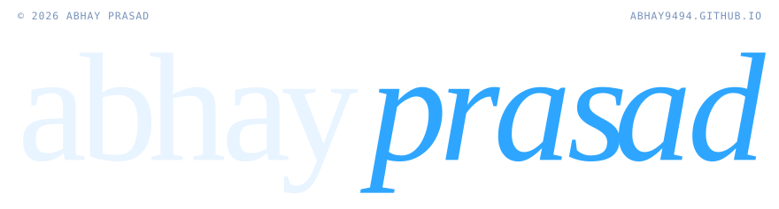</picture></a>
